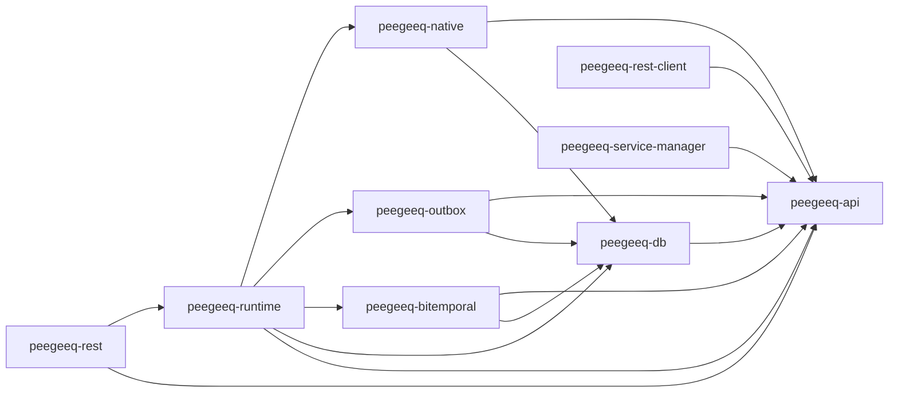
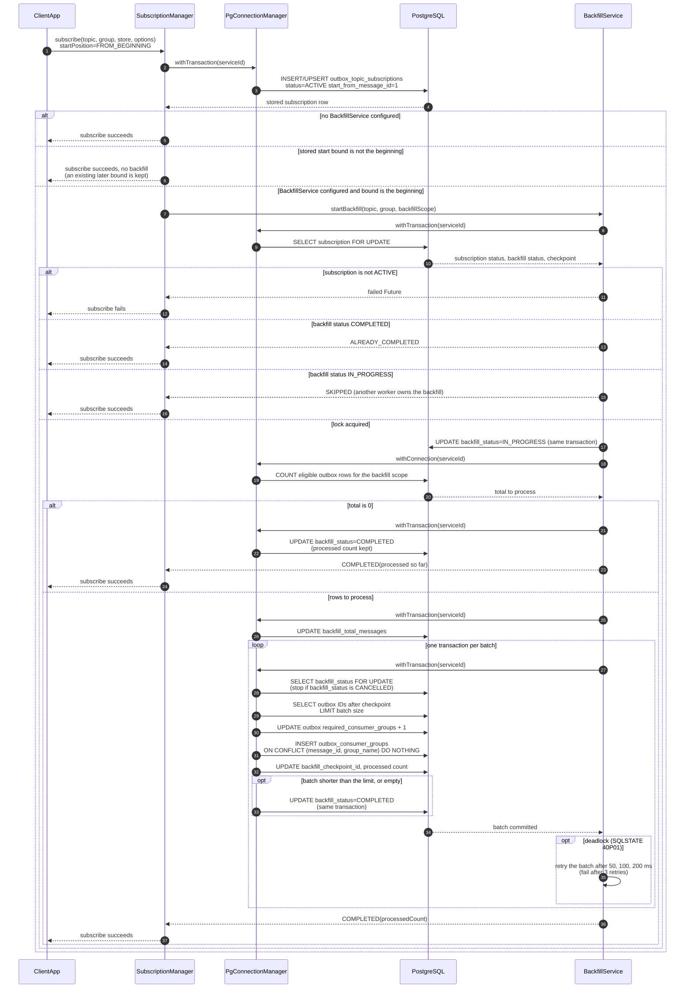

# PeeGeeQ Architecture
© Mark Andrew Ray-Smith Cityline Ltd 2025  
Version 1.0

PeeGeeQ is a message queue and bi-temporal event store built on PostgreSQL and Vert.x 5. Messages and events
are rows in PostgreSQL tables. Producers insert rows; consumers claim and settle them. There is no separate
broker process.

This document describes the modules and their layers, the three storage and delivery models, the delivery
guarantee, when PostgreSQL is the right queue, and the subscription backfill flow.

Related documents: `PEEGEEQ_GETTING_STARTED.md`,
`PEEGEEQ_MESSAGING_GUIDE.md`, `PEEGEEQ_ORDERING_GUIDE.md`,
`PEEGEEQ_EVENT_STORE_GUIDE.md`, `PEEGEEQ_DATABASE_GUIDE.md`,
`PEEGEEQ_CONFIGURATION_GUIDE.md`, `PEEGEEQ_REST_API_GUIDE.md`,
`PEEGEEQ_OPERATIONS_GUIDE.md`.

Statements marked "(read in code, not run)" come from reading the source. They have not been confirmed by a
test run for this document.

## 1. Modules

The root `pom.xml` lists 20 reactor modules. The dependency column lists compile-scope PeeGeeQ dependencies
only.

| Module | Purpose | Depends on |
|---|---|---|
| `peegeeq-api` | Public interfaces and value types: `MessageProducer`, `MessageConsumer`, `Message`, `ConsumerGroup`, `QueueFactory`, `QueueFactoryProvider`, `SubscriptionService`, `EventStore`, `DeadLetterService`, tracing utilities | none |
| `peegeeq-db` | Configuration (`PeeGeeQConfiguration`), connection pools (`PgConnectionManager`), `PeeGeeQManager` lifecycle, setup and templates, subscriptions, backfill, dead letter, recovery, health, metrics, partitioned consumption | api |
| `peegeeq-native` | Native queue on `queue_messages`: `PgNativeQueueFactory`, producer, consumer, consumer group | api, db |
| `peegeeq-outbox` | Outbox queue on `outbox`: `OutboxFactory`, `OutboxProducer`, consumer, consumer group | api, db |
| `peegeeq-bitemporal` | Bi-temporal event store: `PgBiTemporalEventStore`, `BiTemporalEventStoreFactory` | api, db |
| `peegeeq-runtime` | Composition: `PeeGeeQRuntime` wires db, native, outbox and bitemporal and returns API interfaces such as `DatabaseSetupService` | api, db, native, outbox, bitemporal |
| `peegeeq-rest` | Vert.x HTTP server: setups, queues, consumer groups, subscriptions, event stores, management, SSE and WebSocket | api, runtime |
| `peegeeq-rest-client` | Java client for the REST API on Vert.x `WebClient` | api |
| `peegeeq-openapi` | OpenAPI file for the REST API. It describes 17 operations that have no route and omits about 58 registered routes (register D33); the REST API Guide owns endpoint detail | none |
| `peegeeq-service-manager` | Service discovery and federation of PeeGeeQ instances through Consul | api |
| `peegeeq-pg-sidecar` | HTTP sidecar with a `/primary` endpoint for HAProxy health checks: 200 on the write primary, 503 on a replica or when the check query fails | none |
| `peegeeq-pg-failover` | Node-local PostgreSQL writer ownership and supervision; see the Operations Guide | none |
| `peegeeq-migrations` | Flyway scripts and the `RunMigrations` runner. Not part of the application runtime | none |
| `peegeeq-management-ui` | React management console; talks to the REST server | none (npm build) |
| `peegeeq-utilities-ui` | Web utilities interface | none (npm build) |
| `peegeeq-test-support` | Shared test containers, constants, configuration builders and quality guards | none |
| `peegeeq-examples` | Example classes and demonstration tests | api, db, native, outbox, bitemporal, runtime, rest, service-manager |
| `peegeeq-benchmarking` | Performance workloads and measurement tooling | db and test-support; the rest at test scope |
| `peegeeq-integration-tests` | End-to-end tests over the REST server and client | test scope only |
| `peegeeq-coverage-report` | Aggregated JaCoCo report. Packaging `pom`; it declares dependencies on 14 modules so that their coverage can be aggregated | api, db, native, outbox, bitemporal, runtime, rest, rest-client, service-manager, migrations, openapi, examples, integration-tests, test-support |

`peegeeq-examples-spring` holds the Spring Boot examples. It is a separate Maven project, not a reactor module,
and is built on its own.

An arrow points from a module to a module it depends on.

### 1.1 Layers

| Layer | Modules | Role |
|---|---|---|
| Contract | `peegeeq-api` | Interfaces that application code programs against. Depends on no other PeeGeeQ module |
| Infrastructure | `peegeeq-db` | Configuration, pools, schema setup, subscriptions and background jobs shared by the implementations |
| Implementations | `peegeeq-native`, `peegeeq-outbox`, `peegeeq-bitemporal` | One storage and delivery model each (section 2) |
| Composition | `peegeeq-runtime` | Wires the implementations into one set of services |
| Access | `peegeeq-rest`, `peegeeq-rest-client`, `peegeeq-management-ui` | HTTP access and the console |
| Deployment support | `peegeeq-service-manager`, `peegeeq-pg-sidecar`, `peegeeq-pg-failover`, `peegeeq-migrations` | Federation, database health and failover, schema migration |
| Specification and tools | `peegeeq-openapi`, `peegeeq-utilities-ui` | REST specification file and the utilities interface |
| Build and verification | `peegeeq-test-support`, `peegeeq-examples`, `peegeeq-benchmarking`, `peegeeq-integration-tests`, `peegeeq-coverage-report` | Test infrastructure, examples, benchmarks, end-to-end tests, coverage aggregation. Not part of an application runtime |

The following describes the start-up path as read in code, not run. An application creates a `PeeGeeQManager`
from a `PeeGeeQConfiguration`. A `QueueFactoryProvider` creates a `QueueFactory` by implementation type: `native`
or `outbox`. Registration is explicit: a type exists only after `PgNativeFactoryRegistrar.registerWith(provider)`
or `OutboxFactoryRegistrar.registerWith(provider)` has been called. `PeeGeeQRuntime` calls them for the queue
types its `RuntimeConfig` enables. `PgQueueFactoryProvider.createFactory` fails with `IllegalStateException` when
no type is registered. The factory creates producers, consumers, consumer groups and browsers.

`PeeGeeQManager.start` starts the health checks, the metrics timers and the background jobs: the dead-letter
purge, and, when configuration enables them, stuck-message recovery, dead-consumer detection and consumer-group
retry. The stuck-message timer always runs and does nothing when recovery is disabled. The consumer-group retry job acts only on `FAILED` rows in `outbox_consumer_groups`, and no
production code writes those rows. The settings are in `PEEGEEQ_CONFIGURATION_GUIDE.md`
and the operation of the jobs is in `PEEGEEQ_OPERATIONS_GUIDE.md`.

Every table of a setup lives in one configured schema. There is no default schema. The
`PEEGEEQ_DATABASE_GUIDE.md` describes setup, migrations and templates.

## 2. Storage and delivery models

The table is read in code, not run.

| | Native queue | Outbox queue | Bi-temporal event store |
|---|---|---|---|
| Module | `peegeeq-native` | `peegeeq-outbox` | `peegeeq-bitemporal` |
| Table | `queue_messages` | `outbox` | One table per event store, created from the event-store template |
| Producer transaction | Its own transaction for every send | Its own, or the caller's through `sendInExistingTransaction` | Its own, or the caller's through `appendInTransaction` |
| Consumer wake-up | `LISTEN`/`NOTIFY`, polling, or both (`ConsumerMode`) | Polling | `LISTEN`/`NOTIFY` subscriptions; durable subscriptions also reconcile on a 1-second timer |
| Claim | `FOR UPDATE SKIP LOCKED`; row set to `LOCKED` until a visibility deadline | `FOR UPDATE SKIP LOCKED`; row set to `PROCESSING` | Not a queue; events are read, not claimed |
| On success | Row deleted | Row set to `COMPLETED` and kept | Append-only; the store issues no `UPDATE` or `DELETE` on event rows, and a correction is a new version |
| Claim order | `priority DESC, created_at ASC` | `created_at, id` | Query order |
| Main use | Work distribution with low wake-up latency | Publishing a message atomically with business writes | Event history with valid time and transaction time |

Choose the native queue when the producer does not need to share a transaction with business data. Choose the
outbox when the message must commit or roll back with business rows; the
`PEEGEEQ_MESSAGING_GUIDE.md` explains the send modes. Choose the event store when the history
itself is the record; see `PEEGEEQ_EVENT_STORE_GUIDE.md`.

Partitioned, per-key ordered consumption (`OFFSET_WATERMARK`) reads the `outbox` table only. It needs the outbox
producer and a schema built by the Flyway migrations (register D42). See the
`PEEGEEQ_ORDERING_GUIDE.md`.

No production code schedules `CleanupService`, the class that deletes completed outbox rows after their
retention period (register D44). `COMPLETED` outbox rows stay in the table until a caller deletes them, for
example with `OutboxFactory.purgeMessages(topic)`, which deletes every row of the topic (read in code, not run).

## 3. Delivery guarantee: at-least-once

Delivery is at-least-once for both queues and for the partitioned engine. A message can reach a handler more
than once on these paths (read in code, not run):

- The handler succeeds but the completion update fails. The outbox consumer resets the row to `PENDING`.
- An outbox row stays `PROCESSING` longer than the recovery processing timeout. `StuckMessageRecoveryManager`
  resets it to `PENDING`, whether or not the first handler is still running.
- A native handler does not settle within the visibility timeout, or its lock expires. The row returns to
  `AVAILABLE`.
- A partitioned batch fails before its offset commits. The batch is fetched again from the last committed
  offset.
- A producer retries a send after a failure whose outcome it cannot see, for example a connection lost after
  the commit. The `idempotencyKey` header prevents the second row.

The queue does not make handler side effects exactly-once. Handlers must be idempotent; the
`PEEGEEQ_MESSAGING_GUIDE.md` shows the pattern.

`NOTIFY` is a wake-up signal, not the queue. The row is the durable state. A lost notification delays a
message; it does not lose it, provided the consumer also polls (`HYBRID` or `POLLING_ONLY`) or receives a later
notification (read in code, not run).

At-least-once describes redelivery. It does not mean every message reaches every consumer: the
`PEEGEEQ_MESSAGING_GUIDE.md` and `PEEGEEQ_ORDERING_GUIDE.md` list the code
paths that can complete or skip a message without delivering it (registers D1 and D44).

## 4. When PostgreSQL is the right queue

Use PostgreSQL when the queue is part of the transactional data model. Use a broker when the queue is the
runtime distribution fabric.

Consider a common cycle: claim an incoming work item, read and change domain tables, publish a result. If all
three commit in one PostgreSQL transaction, a failure at any step leaves no partial state. An external broker
cannot join that transaction. When a broker message is acknowledged and the database write then fails, the
two systems disagree, and the application needs compensation logic or a saga to repair it. With PeeGeeQ the
outbox row, the business rows and the claim state are rows in the same database, so one transaction covers
them. The outbox consumer reads the `outbox` table directly; no change-data-capture pipeline or broker sits
between the producer and the consumer.

The cost is that a queue table is a demanding PostgreSQL workload. Rows are inserted, claimed, updated and
completed or deleted, often within seconds. Each update creates a new row version, and each delete leaves a
dead tuple. Indexes and the write-ahead log grow with the change rate, and vacuum must keep up. `SKIP LOCKED`
stops workers from blocking each other; it does not make row versions, index maintenance or vacuum free. When
the claim rate rises past what vacuum and the write-ahead log can absorb, latency rises and throughput can fall
sharply. Adding workers can make this worse, not better.

Judge the fit by the shape of the workload, not by its size:

| Workload characteristic | PostgreSQL fit |
|---|---|
| Message must commit atomically with domain state | Strong |
| Controlled claim rate, handlers of moderate duration | Good |
| Duplicate processing is tolerable, or handlers are idempotent | Good |
| Very high rate of very short jobs | Weak |
| Many status transitions per message | Weak |
| Strict global FIFO across all keys | Weak; PeeGeeQ orders per key only (see the Ordering Guide) |
| Queue tables share the primary OLTP database with heavy business traffic | Risky; isolate the schema, the pool and the capacity |
| Unbounded bursts with no backpressure | Risky |

Watch the database, not only message throughput: dead tuples on the queue tables, autovacuum activity, lock and
write-ahead-log wait events, and the age of the oldest pending message. The
`PEEGEEQ_OPERATIONS_GUIDE.md` covers metrics.

## 5. Subscription backfill

A consumer-group subscription with `StartPosition.FROM_BEGINNING` can backfill fan-out bookkeeping for messages
that already exist. The production consumer-group path does not read the tracking rows that the backfill
writes; `PEEGEEQ_MESSAGING_GUIDE.md` explains what the backfill changes for delivery.

Key classes:

- `peegeeq-db/src/main/java/dev/mars/peegeeq/db/subscription/SubscriptionManager.java`
- `peegeeq-db/src/main/java/dev/mars/peegeeq/db/subscription/BackfillService.java`
- `peegeeq-db/src/main/resources/db/templates/base/08b-consumer-table-subscriptions.sql`

### 5.1 Topic subscription with historical backfill

A `FROM_BEGINNING` subscription is stored by `SubscriptionManager`. When a `BackfillService` is configured, the
same `subscribe` call then runs the backfill and completes only after it. A failed backfill fails the `subscribe`
Future. The failure is also logged (read in code, not run).

Notes on the diagram, all read in code, not run:

- The backfill scope comes from `SubscriptionOptions.backfillScope`. The default, `PENDING_ONLY`, covers messages
  that are still `PENDING` or `PROCESSING`. `ALL_RETAINED` also covers retained `COMPLETED` messages.
- The backfill reads the `outbox` table for every subscription store (register D44).
- When the count is 0, the backfill is marked `COMPLETED` at once and keeps the processed count already
  recorded.
- The total is stored in its own transaction before the first batch.
- The cancel check in each batch reads `backfill_status`, not the subscription status.
- `COMPLETED` is written inside the transaction of the final batch: the first batch shorter than the limit, or
  an empty batch.
- A batch that fails with a deadlock (SQLSTATE `40P01`) is retried after 50, 100 and 200 ms; the backfill
  fails after the third retry. Without a Vert.x instance the deadlock fails the backfill at once.

### 5.2 Concurrent backfill coordination and row-level locking

The following is read in code, not run.

- Concurrency control is the row lock on the subscription row (`SELECT ... FOR UPDATE`).
- The worker that takes the lock sets `IN_PROGRESS` in the same transaction. A second worker waits for the lock,
  then reads `IN_PROGRESS` and returns `SKIPPED`.
- A completed backfill returns `ALREADY_COMPLETED` and keeps the recorded processed count.
- Each batch and its checkpoint commit in one transaction. A cancelled backfill resumes from the last committed
  checkpoint on its next start.
- A failure after the lock, other than a retried deadlock, fails the backfill, sets `backfill_status` to
  `FAILED`, and logs an ERROR. A later start resumes from the last committed checkpoint. This was run on
  2026-11-28 on the Jenkins host (`BackfillServiceIntegrationTest`, register D35).
- A process that stops during a backfill, or a failure to record `FAILED`, leaves `backfill_status` at
  `IN_PROGRESS`. Nothing releases it, so later starts return `SKIPPED` until the status is changed by hand
  (register D35).

```mermaid
sequenceDiagram
    autonumber
    participant W1 as Worker 1
    participant W2 as Worker 2
    participant Bf as BackfillService
    participant Cx as PgConnectionManager
    participant DB as PostgreSQL

    par concurrent startBackfill(topic, group)
        W1->>Bf: startBackfill
    and
        W2->>Bf: startBackfill
    end

    Bf->>Cx: withTransaction
    Cx->>DB: SELECT subscription FOR UPDATE

    alt W1 acquires the row lock first
        DB-->>W1: lock + state
        W1->>DB: set IN_PROGRESS
        DB-->>W2: waits, then sees IN_PROGRESS
        W2-->>W2: return SKIPPED

        loop each batch
            W1->>Cx: withTransaction
            W1->>DB: lock subscription row, fetch IDs, update outbox + tracking, checkpoint
            opt final batch (short or empty)
                W1->>DB: mark COMPLETED (same transaction)
            end
        end

        W1-->>W1: COMPLETED
    else already COMPLETED before either starts
        DB-->>W1: COMPLETED
        DB-->>W2: COMPLETED
        W1-->>W1: ALREADY_COMPLETED
        W2-->>W2: ALREADY_COMPLETED
    end
```

Tests that exercise these flows:

- Backfill integration: `BackfillServiceIntegrationTest`
- Concurrency and race safety: `BackfillServiceConcurrencyTest`
- Backfill scope workload: `BackfillScopePerformanceTest`
- Backfill against OLTP load: `P4_BackfillVsOLTPTest`
